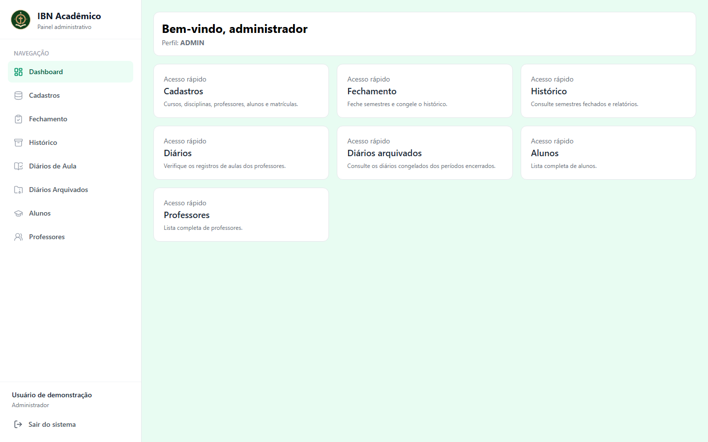
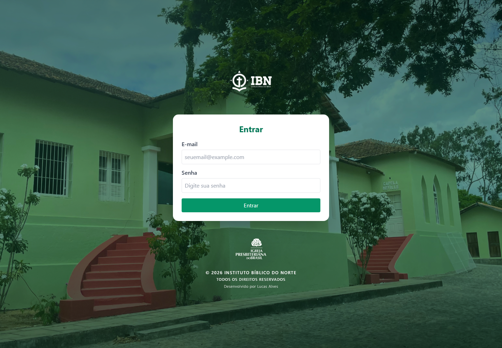
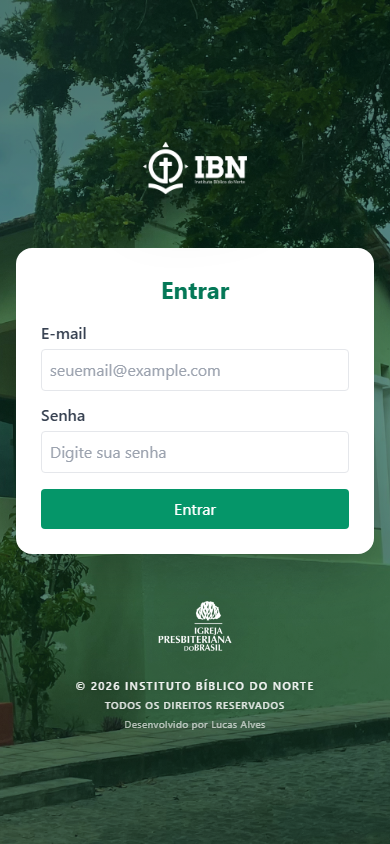

<div align="center">


# IBN Acadêmico

### Da matrícula ao histórico. A rotina acadêmica em um só lugar.

Sistema de gestão acadêmica desenvolvido para o Instituto Bíblico do Norte, com áreas dedicadas à secretaria, aos professores e aos alunos.


[Sobre o projeto](#sobre-o-projeto) · [Funcionalidades](#funcionalidades) · [Interface](#interface) · [Decisões técnicas](#decisões-técnicas) · [Autor](#autor)

</div>



## Sobre o projeto

O IBN Acadêmico foi desenvolvido para apoiar a rotina do **Instituto Bíblico do Norte, em Garanhuns–PE**, reunindo cadastros, matrículas, diários de aula, notas, frequência e históricos acadêmicos.

O sistema está em uso institucional e evolui com as observações da secretaria e dos professores. Seu desenvolvimento parte de uma necessidade real: organizar o acompanhamento dos alunos com uma interface simples, respeitando a flexibilidade do funcionamento acadêmico do IBN.

**Este repositório é uma apresentação de portfólio.** O código-fonte é mantido em um repositório privado. Não são disponibilizadas contas de acesso, credenciais, base de dados ou uma demonstração conectada ao ambiente institucional.

## O desafio

Uma turma de ingresso não determina automaticamente todas as disciplinas que cada aluno precisa cursar. A secretaria precisa ajustar matrículas, acompanhar alunos em diferentes períodos e preservar os resultados após o fechamento.

Para representar essa realidade, o sistema distingue:

- **Coorte (turma base):** o grupo de ingresso do aluno.
- **Oferta de disciplina:** uma disciplina associada a professor e período letivo.
- **Matrícula:** o vínculo individual do aluno com uma oferta.

Essa separação permite organizar o fluxo sem obrigar a instituição a seguir um currículo automaticamente fixado pelo sistema.

## Funcionalidades

| Área | Recursos |
| :--- | :--- |
| Administração e secretaria | Cadastros de cursos, disciplinas, professores, alunos, coortes e ofertas. |
| Matrículas | Matrícula em várias ofertas, cópia entre alunos, busca e organização por turma base. |
| Professor | Acompanhamento das próprias ofertas, lista de alunos, diário de aulas e chamada. |
| Notas e frequência | Lançamento de notas, recuperação e acompanhamento dos critérios de aprovação. |
| Aluno | Disciplinas, informações acadêmicas, perfil e boletim por período. |
| Fechamento | Conferência dos resultados e preservação do histórico de cada aluno. |
| Arquivo institucional | Consulta aos históricos acadêmicos e aos diários arquivados. |
| Relatórios | Impressão de listas, boletins, históricos, aulas e notas/frequência com identidade institucional. |

### Avaliação adaptada às disciplinas

As ofertas podem considerar **nota e frequência** ou **somente frequência**. Quando há recuperação, a terceira nota substitui a menor entre as duas avaliações iniciais no cálculo da média final.

O aluno consegue consultar os boletins dos períodos encerrados, enquanto a secretaria mantém um registro dos resultados e critérios utilizados no fechamento.

## Interface

A identidade visual utiliza verdes institucionais, cards brancos e navegação lateral. As telas possuem tratamento responsivo; operações administrativas de cadastro são direcionadas ao computador.

As capturas apresentam renderizações dos **componentes reais**, preparadas localmente para esta documentação. O painel utiliza um usuário fictício. Nenhuma captura autentica uma conta ou consulta a base da instituição.

<details>
<summary>Tela de login no computador</summary>



</details>

<details>
<summary>Tela de login no celular</summary>

<p align="center">
  
</p>

</details>

A captura móvel utiliza viewport emulado e não substitui testes em dispositivos físicos.

## Fluxo acadêmico

```text
Cadastro de alunos, professores e ofertas
    -> matrícula individual ou em lote
    -> registro das aulas, presenças e notas
    -> acompanhamento pelo aluno
    -> conferência e fechamento pela secretaria
    -> consulta ao histórico e aos diários arquivados
```

## Tecnologias

| Tecnologia | Aplicação no projeto |
| :--- | :--- |
| React 19 + JavaScript/JSX | Componentes, formulários e estados da interface. |
| React Router 7 | Navegação e organização das áreas por perfil. |
| Zustand | Estado de autenticação da aplicação. |
| Firebase Authentication | Autenticação por e-mail e senha. |
| Cloud Firestore | Persistência e acompanhamento das alterações nos dados. |
| Tailwind CSS 3 | Identidade visual e layouts responsivos. |
| Lucide React | Ícones da interface. |
| Vite 7 | Ambiente de desenvolvimento e build do frontend. |
| Firebase Hosting | Hospedagem da aplicação. |

## Decisões técnicas

- **Modelagem orientada à instituição:** distinção entre coorte, oferta e matrícula para representar o funcionamento real do IBN.
- **Separação de responsabilidades:** páginas coordenam os fluxos; componentes organizam formulários e tabelas; serviços concentram o acesso aos dados.
- **Regras acadêmicas compartilhadas:** cálculos de notas, recuperação e frequência são reaproveitados entre as áreas.
- **Atualização por listeners:** as telas acompanham alterações no banco sem depender apenas de recarregamento manual.
- **Preservação por snapshots:** o fechamento registra os resultados e critérios daquele período para consulta posterior.
- **Feedback das operações:** confirmações e mensagens de conclusão ajudam os professores a identificar quando um registro foi salvo.
- **Impressão consistente:** os documentos compartilham logo, cabeçalho e identificação do sistema. A exportação em PDF utiliza a impressão do navegador.

## Meu trabalho no projeto

Atuei na construção e evolução do sistema, desde a organização do modelo acadêmico até a implementação das telas, integração com Firebase e publicação da aplicação.

O projeto reúne desafios de levantamento de requisitos, modelagem de dados, desenvolvimento frontend, integração de serviços e melhoria de experiência a partir do uso real. Também exige cuidado para adaptar funcionalidades existentes sem interromper a rotina da instituição.

## Acesso ao código e à aplicação

O código-fonte e a documentação operacional são mantidos em ambiente privado pelo contexto institucional do projeto. Esta apresentação não distribui o aplicativo e não fornece instruções de acesso à instalação em uso.

Em um processo seletivo, podemos conversar sobre a implementação, as decisões técnicas e as possibilidades de avaliação do trabalho, respeitando a autorização da instituição.

## Autor

Desenvolvido por **[Luks Alves](https://github.com/xLuuks)** para apoiar a rotina acadêmica do Instituto Bíblico do Norte.

Outros projetos: [Local Transcriber](https://github.com/xLuuks/local-transcriber) · [Local Scanner](https://github.com/xLuuks/local-scanner) · [SplitCraft](https://github.com/xLuuks/splitcraft).

O uso da identidade institucional nesta apresentação foi autorizado. Logos, fotografias e marcas pertencem aos respectivos titulares; sua presença aqui não concede autorização de reutilização por terceiros.
